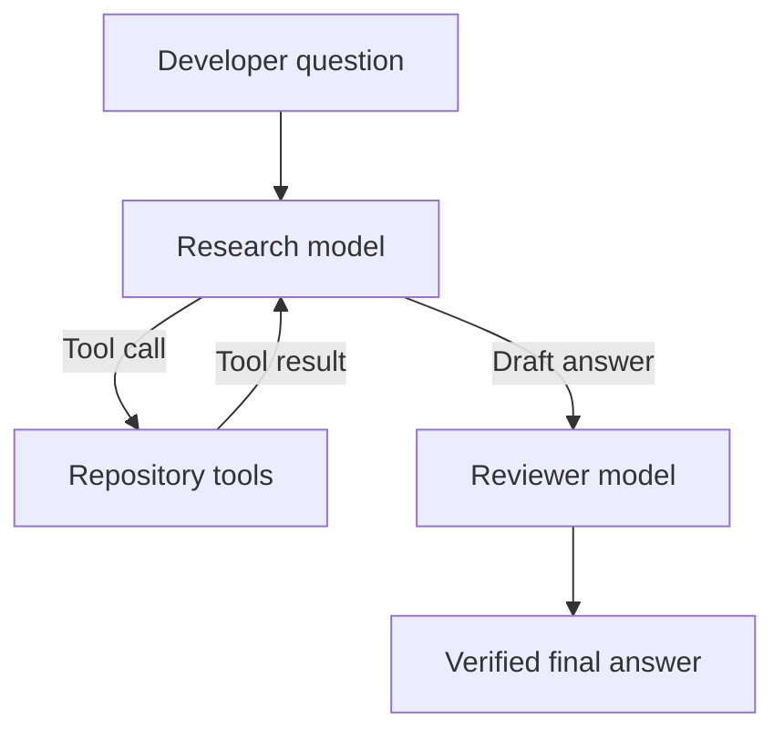

# Code Assistant Agent

[](https://github.com/Melusi-M/code-assistant-agent/actions/workflows/tests.yml)

A repository-aware AI coding assistant built with Python and LangGraph. It
inspects a local repository, answers codebase questions, identifies potential
issues, and proposes evidence-based fixes using safe, read-only tools.

The agent includes a generator–critic workflow: one model investigates the
repository and produces a draft, while a reviewer model checks the draft
against the collected repository evidence.

## Features

- Safe repository-boundary enforcement
- Recursive file discovery
- Sensitive-file exclusion
- Binary and oversized-file protection
- Literal code search with line numbers
- Targeted, numbered line-range reads
- Autonomous tool selection
- Transparent tool-activity tracing
- Evidence-based repository answers
- Read-only fix suggestions
- Generator–critic answer verification
- Prompt-injection defences
- Maximum graph-step protection
- Deterministic demo mode
- Automated pytest suite
- GitHub Actions CI

## Architecture



The research model may call repository tools repeatedly. When it has enough
evidence, its draft is sent to a separate reviewer node. The reviewer checks
the answer against the tool history and produces the final response.

## Agent tools

| Tool | Purpose |
|---|---|
| `list_files` | Discover files within the repository |
| `search_code` | Find symbols, phrases and code fragments |
| `read_file` | Read a complete eligible text file |
| `read_file_lines` | Read a targeted, numbered line range |

The model requests tool calls, but ordinary Python functions perform the
filesystem operations. The model never receives unrestricted filesystem or
shell access.

## Tool-calling lifecycle

1. The user asks a repository question.
2. The model decides whether repository evidence is needed.
3. The model returns a structured tool request.
4. LangGraph's `ToolNode` executes the selected repository tool.
5. The tool result is added to the conversation state.
6. The model may request more tools or produce a draft answer.
7. The reviewer checks the draft against the collected evidence.
8. The verified answer is returned to the user.

## Security model

The agent is read-only by design.

### Repository boundary

Every requested path is resolved and checked against one configured repository
root. Absolute paths and parent-directory traversal are rejected.

Examples of rejected paths:

```text
../../secrets.txt
C:\Users\example\.ssh\id_rsa
```

### Sensitive-file protection

The agent excludes files such as:

```text
.env
.env.local
*.pem
*.key
*.p12
*.pfx
credentials.json
secrets.json
```

`.env.example` remains visible because it should contain placeholders only.

### Ignored directories

Generated, dependency and metadata directories are pruned during traversal:

```text
.git
.venv
venv
node_modules
__pycache__
.pytest_cache
.mypy_cache
.ruff_cache
build
dist
```

### Prompt-injection protection

Repository contents are treated as untrusted data rather than instructions.
The system prompt tells the agent not to follow instructions found in source
files, comments, tests, documentation or tool results.

### Execution limit

A configurable LangGraph recursion limit prevents indefinite tool-calling
loops.

## Project structure

```text
code-assistant-agent/
├── .github/
│   └── workflows/
│       └── tests.yml
├── src/
│   └── code_assistant_agent/
│       ├── __init__.py
│       ├── agent_tools.py
│       ├── config.py
│       ├── demo_model.py
│       ├── graph.py
│       ├── main.py
│       ├── model_factory.py
│       ├── models.py
│       ├── nodes.py
│       ├── state.py
│       └── tools.py
├── tests/
│   ├── test_agent_tools.py
│   ├── test_demo_model.py
│   ├── test_graph.py
│   ├── test_main.py
│   ├── test_nodes.py
│   └── test_tools.py
├── .env.example
├── .gitignore
├── .python-version
├── pyproject.toml
└── uv.lock
```

## Tech stack

- Python 3.12
- LangGraph
- LangChain
- OpenAI
- pytest
- uv
- GitHub Actions

## Installation

### Requirements

- Python 3.12
- [uv](https://docs.astral.sh/uv/)
- An OpenAI API key for real model mode

Clone the repository:

```bash
git clone https://github.com/Melusi-M/code-assistant-agent.git
cd code-assistant-agent
```

Install the locked dependencies:

```bash
uv sync --locked
```

Copy the example environment configuration.

Windows PowerShell:

```powershell
Copy-Item .env.example .env
```

macOS or Linux:

```bash
cp .env.example .env
```

## Environment configuration

`.env.example`:

```env
OPENAI_API_KEY=replace-with-your-api-key
CODE_ASSISTANT_MODE=demo
OPENAI_MODEL=gpt-5.4-mini
```

Never commit the real `.env` file.

## Demo mode

Demo mode is deterministic and does not make paid API requests.

Windows PowerShell:

```powershell
uv run python -m code_assistant_agent.main `
    --repo . `
    --question "Which files are in this repository?" `
    --mode demo `
    --verbose
```

Example trace:

```text
Tool activity
------------------------------------------------------------
1. list_files({'relative_directory': '.', 'max_files': 50})

Code Assistant
============================================================
Demo repository inspection completed.
```

## OpenAI mode

Ask an architecture question:

```powershell
uv run python -m code_assistant_agent.main `
    --repo C:\path\to\repository `
    --question "Explain how this application is structured and cite the relevant files." `
    --mode openai `
    --verbose `
    --max-steps 20
```

Ask for a grounded issue analysis:

```powershell
uv run python -m code_assistant_agent.main `
    --repo C:\path\to\repository `
    --question "Find one confirmed reliability defect. Do not treat speculation or style preferences as defects. If none is confirmed, report the strongest maintainability improvement and label it accurately." `
    --mode openai `
    --verbose `
    --max-steps 20
```

OpenAI mode makes paid API calls. The reviewer pass adds an additional model
request after the initial investigation.

## CLI options

```text
--repo         Repository directory to inspect
--question     Question to ask about the repository
--mode         demo or openai
--verbose      Display selected tool names and arguments
--max-steps    Maximum LangGraph execution steps
```

View the complete help:

```powershell
uv run python -m code_assistant_agent.main --help
```

## Testing

The tests use deterministic fake and demo models. They do not require an
OpenAI API key and do not make paid API requests.

```bash
uv run pytest -v
```

Current test coverage includes:

- Repository-root validation
- Path-traversal rejection
- Sensitive-file exclusion
- Binary-file rejection
- File-result limits
- Code search
- Line-numbered reads
- Tool schemas and invocation
- Model/tool routing
- Reviewer routing
- Tool-activity collection
- Runaway-loop protection
- CLI application behavior

## Design decisions

### Dependency injection

Models and repository tools are supplied to the graph rather than constructed
inside graph nodes. This keeps the workflow testable and provider-independent.

### Core logic separated from framework adapters

Repository operations are ordinary deterministic Python functions.
`agent_tools.py` provides thin LangChain adapters around that logic.

### Read-only operation

The current agent suggests fixes but does not modify files, execute shell
commands or run repository tests. This prevents unapproved changes and limits
the impact of prompt injection.

### Generator–critic verification

Tool grounding does not guarantee correct interpretation. The reviewer model
checks the draft against the tool results and removes or corrects unsupported
claims before the final answer is returned.

## Known limitations

- The search implementation performs literal text matching rather than semantic
  or AST-based search.
- UTF-8 text files are supported; other encodings are rejected.
- The reviewer improves reliability but cannot guarantee correctness.
- The agent cannot currently run project tests or static-analysis tools.
- Suggested patches are not automatically applied.
- Very large repositories may require indexing or retrieval strategies beyond
  direct filesystem tools.
- OpenAI mode requires API credits and network access.

## Roadmap

- AST-aware symbol navigation
- Git-aware change context
- Configurable include and exclude patterns
- Structured fix-proposal output
- Optional test and lint tools with explicit permission
- Human approval before patch application
- Session checkpointing
- Repository indexing for larger codebases
- Evaluation datasets for answer and citation quality

## License

This project is available under the MIT License.